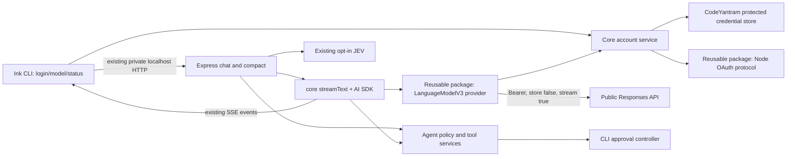

# ChatGPT plan integration for CodeYantram

## 1. Executive Summary

**Recommendation:** add a distinct `chatgpt` model source backed by the **official Sign in with ChatGPT (SIWC) open-source dynamic-registration flow** and the public `https://api.openai.com/v1/responses` HTTP endpoint. Put reusable OAuth protocol and AI SDK `LanguageModelV3` transport in a new workspace package, provisionally `@codeyantram/ai-sdk-provider-chatgpt`, so it can be hardened and published separately later. Keep CodeYantram-specific secret storage, account selection, `streamText` loop, tool catalog, approval policy, JEV integration, transcript, and compaction ownership in existing packages. Do not use Codex CLI or OpenCode as a runtime dependency.

**Owner decision:** use OpenCode's newer dynamic-registration approach as a design reference, implemented under CodeYantram's own name and local host ID. The legacy OpenCode URL containing `client_id=app_EMoamEEZ73f0CkXaXp7hrann`, `/oauth/authorize`, `codex_cli_simplified_flow`, and `originator=opencode` is outside this plan. Its client registration and callback belong to OpenCode; this plan creates a CodeYantram connection through the documented `/api/accounts/authorize` flow. [Official registration](https://developers.openai.com/siwc/token-sharing-open-source/sign-in), [OpenCode new `authorizeURL`](https://github.com/anomalyco/opencode/blob/e31136bdbdb43e934d8bbd81e75a2065a2625699/packages/core/src/plugin/provider/chatgpt.ts#L513-L538), [OpenCode legacy `authorizeURL`](https://github.com/anomalyco/opencode/blob/e31136bdbdb43e934d8bbd81e75a2065a2625699/packages/core/src/plugin/provider/openai.ts#L401-L414).

**Authorization status (2026-10-11):** an officially documented route exists for open-source tools and locally run personal projects with eligible ChatGPT Plus/Pro accounts. It issues a client ID during user consent; a preassigned partner ID or client secret is not required for that route. CodeYantram's owner has confirmed the Node server will always run locally. OpenAI's published guide does not require MIT or any named license, and the absence of a local `LICENSE` does not alone block a personal, locally run proof of concept. GitHub's public repository at the inspected URL has a different, older MIT-licensed tree; it does not prove the terms of this local revision. If distributing this revision as open source, confirm the rights and license that apply to it. Before live use, verify loopback-only operation and account/workspace eligibility. Existing BYOK providers remain available. [Official quickstart](https://developers.openai.com/siwc/quickstart), [OSS overview](https://developers.openai.com/siwc/token-sharing-open-source), [cookbook](https://developers.openai.com/cookbook/articles/sign-in-with-chatgpt).

**Production boundary:** the old OpenCode Codex path embeds a client ID and calls `chatgpt.com/backend-api/codex`; that is observed source behavior, not an authorization grant to CodeYantram. The supported SIWC route explicitly says to use the public Responses API and not the ChatGPT backend. [OpenCode legacy `OpenAIPlugin`](https://github.com/anomalyco/opencode/blob/e31136bdbdb43e934d8bbd81e75a2065a2625699/packages/core/src/plugin/provider/openai.ts#L15-L27), [official models and inference](https://developers.openai.com/siwc/token-sharing-open-source/models-and-inference).

## 2. Research Methodology and Inspected Versions

* OpenCode: shallow clone of `https://github.com/anomalyco/opencode`, commit **`e31136bdbdb43e934d8bbd81e75a2065a2625699`** (HEAD at inspection on 2026-10-11). Findings below refer to that commit, including code that is commented out or only covered by mocks; no live OpenCode OAuth or inference call was made.
* CodeYantram: local HEAD **`c6a7ece5d58b5bb897949e435d2519f8bdbe0e85`**, inspected read-only. The unrelated untracked `ZAI_PROVIDER_PLAN.md` existed before this work. The local root is an npm/Node workspaces project with five packages; the public GitHub page observed via browsing describes an older Bun tree, so this plan uses the local checkout as authority. No live tokens or provider requests were used.
* Official OpenAI documentation: the three requested pages plus SIWC [registration](https://developers.openai.com/siwc/token-sharing-open-source/sign-in), [accounts/sessions](https://developers.openai.com/siwc/token-sharing-open-source/profiles-and-sessions), [models/inference](https://developers.openai.com/siwc/token-sharing-open-source/models-and-inference), [token reference](https://developers.openai.com/siwc/token-sharing-open-source/token-reference), [errors](https://developers.openai.com/siwc/token-sharing-open-source/errors-and-recovery), and [preview limitations](https://developers.openai.com/siwc/token-sharing-open-source/preview-limitations), fetched on 2026-10-11. These preview requirements can change; recheck before implementation.
* Local dependency versions: `ai@7.0.123`, `@ai-sdk/openai@4.0.81`, `@ai-sdk/openai-compatible@3.0.60`, `zod@4.6.5`, `vitest@5.0.3`. The installed `@ai-sdk/provider` declaration exposes `LanguageModelV3` with required `doStream` **and** `doGenerate` methods; the adapter must support both without sending a nonstreaming SIWC request.

Evidence labels: **Official** means an OpenAI page documents it; **Observed** means it appears in the pinned OpenCode source; **Proposed** is a CodeYantram design choice; **Unverified** requires an account test or OpenAI confirmation.

## 3. OpenCode Implementation Findings

### OAuth and credentials

| Finding | Evidence and status |
| --- | --- |
| **Observed, new SIWC path.** `ChatGPTPlugin.signIn` persists a `urn:uuid:` host ID, creates PKCE S256, `state`, and `nonce`, binds an ephemeral `127.0.0.1` listener at `/auth/callback`, checks callback state, takes the issued `client_id`, and exchanges the code using that ID and the exact redirect URI. `authorizeURL` requests `openid profile email offline_access resource.invoke chatgpt.tokens.use.direct`, resource `https://api.openai.com/v1`, and uses `dynamic_agent_client` only for initial registration. | [`packages/core/src/plugin/provider/chatgpt.ts`, `signIn`, `listen`, `generatePKCE`, `authorizeURL`](https://github.com/anomalyco/opencode/blob/e31136bdbdb43e934d8bbd81e75a2065a2625699/packages/core/src/plugin/provider/chatgpt.ts#L92-L205), [`authorizeURL`](https://github.com/anomalyco/opencode/blob/e31136bdbdb43e934d8bbd81e75a2065a2625699/packages/core/src/plugin/provider/chatgpt.ts#L500-L539). This closely follows the official OSS flow. |
| **Observed.** The new path requires the granted direct-use scope and an ID token; `verifyIDToken` uses `jose`/JWKS and checks RS256, issuer, audience, expiry, `sub`, and nonce. `credential` stores access/refresh tokens, expiry, issued client ID, and scopes. `refresh` uses the issued client ID and resource; `Integration.connection.resolve` refreshes within five minutes of expiry and updates the stored credential. | [`chatgpt.ts`, callback, `verifyIDToken`, `credential`, `refresh`](https://github.com/anomalyco/opencode/blob/e31136bdbdb43e934d8bbd81e75a2065a2625699/packages/core/src/plugin/provider/chatgpt.ts#L165-L193), [`verifyIDToken`](https://github.com/anomalyco/opencode/blob/e31136bdbdb43e934d8bbd81e75a2065a2625699/packages/core/src/plugin/provider/chatgpt.ts#L456-L497), [`refresh`](https://github.com/anomalyco/opencode/blob/e31136bdbdb43e934d8bbd81e75a2065a2625699/packages/core/src/plugin/provider/chatgpt.ts#L385-L401), [`packages/core/src/integration.ts`, `connection.resolve`](https://github.com/anomalyco/opencode/blob/e31136bdbdb43e934d8bbd81e75a2065a2625699/packages/core/src/integration.ts#L723-L740). |
| **Observed limitation.** The new path's credential schema does not retain the ID token, verified subject, or email, and the shown reauthorization path does not check that a new verified subject matches the selected saved account. It fails sign-in when consent grants identity but not direct-use permission. The official flow instead allows identity-only state and requires distinct account mapping and returning-account identity checks. | [`chatgpt.ts`, callback and credential`](https://github.com/anomalyco/opencode/blob/e31136bdbdb43e934d8bbd81e75a2065a2625699/packages/core/src/plugin/provider/chatgpt.ts#L165-L183), [`credential`](https://github.com/anomalyco/opencode/blob/e31136bdbdb43e934d8bbd81e75a2065a2625699/packages/core/src/plugin/provider/chatgpt.ts#L489-L497); [official registration](https://developers.openai.com/siwc/token-sharing-open-source/sign-in), [accounts](https://developers.openai.com/siwc/token-sharing-open-source/profiles-and-sessions). |
| **Observed storage/logout.** OpenCode's generic `Credential` service stores OAuth values as JSON in SQLite and supports removal. `Integration.connection.resolve` handles refresh. The inspected `ChatGPTPlugin` has no dedicated SIWC revocation/logout implementation; therefore remote revocation on logout is not established by this source. At-rest encryption and file permissions were not verified by this inspection. | [`packages/core/src/credential.ts`, `Credential.Service`](https://github.com/anomalyco/opencode/blob/e31136bdbdb43e934d8bbd81e75a2065a2625699/packages/core/src/credential.ts#L37-L60), [`packages/core/src/credential/sql.ts`, `CredentialTable`](https://github.com/anomalyco/opencode/blob/e31136bdbdb43e934d8bbd81e75a2065a2625699/packages/core/src/credential/sql.ts#L1-L14), [`chatgpt.ts`, `ChatGPTPlugin`](https://github.com/anomalyco/opencode/blob/e31136bdbdb43e934d8bbd81e75a2065a2625699/packages/core/src/plugin/provider/chatgpt.ts#L208-L363). |
| **Observed, legacy path only.** `OpenAIPlugin` still offers browser and device-code methods using a fixed Codex client ID, `/oauth/authorize` and `/oauth/token`, special `codex_cli_simplified_flow`, and a `chatgpt.com/backend-api/codex` base URL with `originator`, `x-codex-beta-features`, and account/session headers. It decodes account ID from JWT payload without cryptographic verification in `claim`. These are **not** SIWC production instructions. | [`packages/core/src/plugin/provider/openai.ts`, constants, `browser`, `headless`](https://github.com/anomalyco/opencode/blob/e31136bdbdb43e934d8bbd81e75a2065a2625699/packages/core/src/plugin/provider/openai.ts#L15-L230), [`OpenAIPlugin` routing/model filter](https://github.com/anomalyco/opencode/blob/e31136bdbdb43e934d8bbd81e75a2065a2625699/packages/core/src/plugin/provider/openai.ts#L232-L329), [`authorizeURL`, `claim`](https://github.com/anomalyco/opencode/blob/e31136bdbdb43e934d8bbd81e75a2065a2625699/packages/core/src/plugin/provider/openai.ts#L401-L430). |

### Models, transport, agent loop, and tests

| Finding | Evidence and status |
| --- | --- |
| **Observed.** New-path `fetchModels` calls bearer `GET /v1/models`, filters `visibility === "list"` and `supported_in_api`, and `deriveModels` can merge remote metadata, effort levels, and context window. **But active discovery/refresh wiring is commented out at this commit**; `ChatGPTPlugin` currently exposes a fixed fallback set and disables pro-mode models. Do not present active dynamic discovery as implemented in OpenCode. | [`chatgpt.ts`, `RemoteModel`, fallback, `ChatGPTPlugin`](https://github.com/anomalyco/opencode/blob/e31136bdbdb43e934d8bbd81e75a2065a2625699/packages/core/src/plugin/provider/chatgpt.ts#L29-L90), [`ChatGPTPlugin` model transforms and commented refresh](https://github.com/anomalyco/opencode/blob/e31136bdbdb43e934d8bbd81e75a2065a2625699/packages/core/src/plugin/provider/chatgpt.ts#L283-L362), [`fetchModels`, `deriveModels`](https://github.com/anomalyco/opencode/blob/e31136bdbdb43e934d8bbd81e75a2065a2625699/packages/core/src/plugin/provider/chatgpt.ts#L404-L453). |
| **Observed.** The new path overlays `baseURL: https://api.openai.com/v1`, HTTP transport, summary compaction, and session headers. It stops retries for named subscription admission/limit errors. Legacy path instead rewrites requests to the backend and hardcodes `400_000` context/`272_000` input limits. The hardcoded legacy values are not authoritative for SIWC models. | [`chatgpt.ts`, retry/request/provider hooks](https://github.com/anomalyco/opencode/blob/e31136bdb43e934d8bbd81e75a2065a2625699/packages/core/src/plugin/provider/chatgpt.ts#L259-L323), [`openai.ts`, legacy limits and headers](https://github.com/anomalyco/opencode/blob/e31136bdbdb43e934d8bbd81e75a2065a2625699/packages/core/src/plugin/provider/openai.ts#L256-L323). |
| **Observed.** OpenCode's current model abstraction is its own `@opencode/ai`, **not a Vercel AI SDK provider**. `providers/openai.ts` routes OpenAI models to a Responses protocol. `openai-responses.ts` lowers tool namespaces and choices, chooses HTTP SSE, defaults to `store:false` plus encrypted reasoning include, and parses reasoning/tool output via `open-responses.ts`. This generic provider also contains hosted-tool and WebSocket support; those generic capabilities are not automatically available on the SIWC route. | [`packages/ai/src/providers/openai.ts`, `configure`, `model`](https://github.com/anomalyco/opencode/blob/e31136bdbdb43e934d8bbd81e75a2065a2625699/packages/ai/src/providers/openai.ts#L25-L36), [`configure`](https://github.com/anomalyco/opencode/blob/e31136bdbdb43e934d8bbd81e75a2065a2625699/packages/ai/src/providers/openai.ts#L88-L125), [`packages/ai/src/protocols/openai-responses.ts`, `fromRequest`, `protocol`, `route`](https://github.com/anomalyco/opencode/blob/e31136bdbdb43e934d8bbd81e75a2065a2625699/packages/ai/src/protocols/openai-responses.ts#L161-L215), [`route`](https://github.com/anomalyco/opencode/blob/e31136bdbdb43e934d8bbd81e75a2065a2625699/packages/ai/src/protocols/openai-responses.ts#L280-L331), [`packages/ai/src/protocols/open-responses.ts`, `lowerMessages`, `mapUsage`, `step`](https://github.com/anomalyco/opencode/blob/e31136bdbdb43e934d8bbd81e75a2065a2625699/packages/ai/src/protocols/open-responses.ts#L630-L760), [`step`](https://github.com/anomalyco/opencode/blob/e31136bdbdb43e934d8bbd81e75a2065a2625699/packages/ai/src/protocols/open-responses.ts#L1325-L1465). |
| **Observed compatibility caveat.** Generic `OpenResponses.coreFields` and `lowerGeneration` admit fields such as `max_output_tokens`, `temperature`, `top_p`, `metadata`, and `truncation` that SIWC preview forbids. Its parser emits a finish for `response.incomplete`, whereas official SIWC guidance says to handle incomplete separately from completed success. These generic facilities need a SIWC-specific contract gate. Top-level JSON structured-output lowering was not established in the inspected OpenCode Responses body; structured **tool arguments/errors** are covered. | [`packages/ai/src/protocols/open-responses.ts`, `coreFields`](https://github.com/anomalyco/opencode/blob/e31136bdbdb43e934d8bbd81e75a2065a2625699/packages/ai/src/protocols/open-responses.ts#L255-L301), [`lowerGeneration`](https://github.com/anomalyco/opencode/blob/e31136bdbdb43e934d8bbd81e75a2065a2625699/packages/ai/src/protocols/open-responses.ts#L780-L809), [`onResponseFinish`, `step`](https://github.com/anomalyco/opencode/blob/e31136bdbdb43e934d8bbd81e75a2065a2625699/packages/ai/src/protocols/open-responses.ts#L1322-L1365), [`step`](https://github.com/anomalyco/opencode/blob/e31136bdbdb43e934d8bbd81e75a2065a2625699/packages/ai/src/protocols/open-responses.ts#L1458-L1467); [official preview limits](https://developers.openai.com/siwc/token-sharing-open-source/preview-limitations). |
| **Observed.** `OpenResponses.mapUsage` preserves input/output/total and cached/reasoning token counts from terminal usage; `open-responses.ts` parses text, tool calls, reasoning summaries, terminal failure and explicit errors. The runner's retry policy caps attempts and honors bounded retry-after, while the new ChatGPT plugin suppresses retries for named subscription failures. Neither OpenCode's catalog cost zeroing nor the legacy context constants define a subscription quota or reliable remaining allowance. | [`packages/ai/src/protocols/open-responses.ts`, `mapUsage`](https://github.com/anomalyco/opencode/blob/e31136bdbdb43e934d8bbd81e75a2065a2625699/packages/ai/src/protocols/open-responses.ts#L850-L866), [`step`](https://github.com/anomalyco/opencode/blob/e31136bdbdb43e934d8bbd81e75a2065a2625699/packages/ai/src/protocols/open-responses.ts#L1420-L1467), [`packages/core/src/session/runner/retry.ts`, `policy`](https://github.com/anomalyco/opencode/blob/e31136bdbdb43e934d8bbd81e75a2065a2625699/packages/core/src/session/runner/retry.ts#L31-L90), [`chatgpt.ts`, `nonRetryableSharingCodes`](https://github.com/anomalyco/opencode/blob/e31136bdbdb43e934d8bbd81e75a2065a2625699/packages/core/src/plugin/provider/chatgpt.ts#L48-L56). |
| **Observed.** The OpenCode runner starts local tools after provider tool-call events, records results, handles continuation, cancellation, and bounded retry centrally. `to-llm-message.ts` replays calls and results. Its own tool registry, permissions, session state, and error policy drive the loop; the provider is inference plumbing. | [`packages/core/src/session/runner/step.ts`, `executeTool`, `providerStream`](https://github.com/anomalyco/opencode/blob/e31136bdbdb43e934d8bbd81e75a2065a2625699/packages/core/src/session/runner/step.ts#L90-L135), [`to-llm-message.ts`, `toolCall`, `toolResult`](https://github.com/anomalyco/opencode/blob/e31136bdbdb43e934d8bbd81e75a2065a2625699/packages/core/src/session/runner/to-llm-message.ts#L111-L147), [`retry.ts`, `policy`](https://github.com/anomalyco/opencode/blob/e31136bdbdb43e934d8bbd81e75a2065a2625699/packages/core/src/session/runner/retry.ts#L31-L90). |
| **Observed tests.** New-path tests cover auth URL, stable host ID, loopback callback errors/mismatched client, model fallback and API-key isolation, retry classification, routing, compaction, and reasoning settings. Generic Responses tests cover tool lowering, streaming interleaving, reasoning, usage, continuation, and malformed/incomplete events. The inspected new-path tests do **not** prove a successful live SIWC authorization plus streaming tool round trip; several dynamic-discovery tests are commented out. | [`packages/core/test/plugin/provider-chatgpt.test.ts`](https://github.com/anomalyco/opencode/blob/e31136bdbdb43e934d8bbd81e75a2065a2625699/packages/core/test/plugin/provider-chatgpt.test.ts#L241-L465), [`provider-chatgpt.test.ts`, fallback test](https://github.com/anomalyco/opencode/blob/e31136bdbdb43e934d8bbd81e75a2065a2625699/packages/core/test/plugin/provider-chatgpt.test.ts#L693-L835), [`packages/core/test/plugin/provider-openai.test.ts`](https://github.com/anomalyco/opencode/blob/e31136bdbdb43e934d8bbd81e75a2065a2625699/packages/core/test/plugin/provider-openai.test.ts#L67-L255), [`packages/ai/test/provider/openai-responses.test.ts`](https://github.com/anomalyco/opencode/blob/e31136bdbdb43e934d8bbd81e75a2065a2625699/packages/ai/test/provider/openai-responses.test.ts#L1550-L1608), [`openai-responses.test.ts`, stream tests](https://github.com/anomalyco/opencode/blob/e31136bdbdb43e934d8bbd81e75a2065a2625699/packages/ai/test/provider/openai-responses.test.ts#L2120-L2185), [`packages/ai/test/provider/open-responses-finals.test.ts`](https://github.com/anomalyco/opencode/blob/e31136bdbdb43e934d8bbd81e75a2065a2625699/packages/ai/test/provider/open-responses-finals.test.ts#L19-L87). |

## 4. Official OpenAI Authorization and Policy Findings

| Classification | Finding |
| --- | --- |
| **Officially documented and supported** | SIWC open-source dynamic registration is available for open-source tools and local personal projects. Eligible Plus/Pro users can authorize plan-backed **eligible** Responses API requests. The client gets an issued ID at consent; `dynamic_agent_client` is an initial registration entrypoint, not an app-wide credential, and no partner secret/API key is needed for this OSS route. Identity-only commercial sign-in and paid/remotely hosted plan usage have different availability/approval conditions. [Quickstart](https://developers.openai.com/siwc/quickstart), [cookbook](https://developers.openai.com/cookbook/articles/sign-in-with-chatgpt), [registration](https://developers.openai.com/siwc/token-sharing-open-source/sign-in). |
| **Officially documented and supported** | PKCE S256, state, nonce, exact `127.0.0.1` loopback `/auth/callback`, scopes `openid profile email offline_access resource.invoke chatgpt.tokens.use.direct`, resource `https://api.openai.com/v1`, issued-client code exchange at `https://auth.openai.com/api/accounts/oauth/token`, JWKS ID-token verification, and granted-scope check. Returning sign-in reuses the issued ID and same host ID; verified `sub` must match before replacing selected credentials. [Registration](https://developers.openai.com/siwc/token-sharing-open-source/sign-in). |
| **Officially documented and supported** | `GET https://api.openai.com/v1/models` with the selected connection's access token provides account-specific model slugs and display names; use listed models rather than inferring Plus/Pro catalog access from a hardcoded name. `POST /v1/responses` uses bearer token, `store:false`, `stream:true`, HTTP event stream, and success only on `response.completed`. A model shown in docs is an example, not a guaranteed entitlement. [Models/inference](https://developers.openai.com/siwc/token-sharing-open-source/models-and-inference). |
| **Officially documented and supported; architectural inference stated** | The direct route permits function/custom tool definitions (namespaces or `additional_tools` items), and the cookbook describes building the app's own harness. CodeYantram's own local loop is a reasonable inference from those documented capabilities; there is no requirement in these pages to delegate it to Codex CLI. The SIWC preview excludes many other request fields and hosted tools. Explicit system-role message items are rejected; use `instructions` or developer messages. HTTP requires full history in `input`, not `previous_response_id`. [Preview limitations](https://developers.openai.com/siwc/token-sharing-open-source/preview-limitations), [cookbook](https://developers.openai.com/cookbook/articles/sign-in-with-chatgpt). |
| **Officially documented and supported** | Access tokens last about one hour; refresh tokens last 30 days and rotate on successful refresh. Serialize refreshes, persist new access/refresh pair atomically, retain per-client account mapping, and attempt refresh-token revocation on logout. Plus has a shared five-hour usage limit across apps; Pro is not subject to that particular five-hour limit, but eligibility and other limits still apply. [Token reference](https://developers.openai.com/siwc/token-sharing-open-source/token-reference), [accounts](https://developers.openai.com/siwc/token-sharing-open-source/profiles-and-sessions). |
| **Officially documented and supported** | Direct-admission 401/403/503 and structured subscription errors have distinct recovery; usage-limit errors can arrive **after** text deltas as `response.failed`. Do not treat partial text as a successful turn, retry deterministic 4xx, or silently rebill through BYOK. [Errors/recovery](https://developers.openai.com/siwc/token-sharing-open-source/errors-and-recovery), [models/inference](https://developers.openai.com/siwc/token-sharing-open-source/models-and-inference). |
| **Confirmed owner intent; remaining verification** | The Node server will always run locally. Verify the intended local-only binding and control-plane protections in the implementation, and verify account/workspace eligibility with an authorized sign-in. There is no local `LICENSE`, but OpenAI does not name a required license and also permits locally run personal projects. Root `package.json` says `private:true`; that field controls npm publishing and is **not** an OpenAI eligibility verdict. The public GitHub page is an older revision; confirm licensing rights before any open-source release. [OSS overview](https://developers.openai.com/siwc/token-sharing-open-source), [cookbook](https://developers.openai.com/cookbook/articles/sign-in-with-chatgpt). |
| **Unverified / experimental** | Which models, effort levels, context windows, response-format controls, reasoning summaries/encrypted state, and exact tool namespace wire shape are returned/accepted for a real selected Plus/Pro workspace. Discovery metadata and SIWC preview limit the answer. Test one authorized account; do not hardcode OpenCode's fallback catalog or legacy window. Structured **function argument schemas** are part of function tools, while top-level JSON structured output on this route is not confirmed here and should be gated separately. [Models/inference](https://developers.openai.com/siwc/token-sharing-open-source/models-and-inference), [preview limitations](https://developers.openai.com/siwc/token-sharing-open-source/preview-limitations). |

**Official-flow difference from legacy OpenCode:** SIWC uses a newly issued user/workspace-bound client ID, signed/validated identity, explicit direct-use scope and public resource, and public `/v1/responses`. The legacy fixed-ID/backend route and its headers are outside that contract. OpenCode's newer SIWC source is useful implementation evidence, but its omissions and commented-out discovery must not be copied as requirements.

## 5. CodeYantram Current Architecture

| Boundary | Inspected source and implication |
| --- | --- |
| Workspaces | Root `package.json` declares `server`, `cli`, `core`, `graph`, `shared`. `shared` holds Zod wire schemas/model catalog/config; `core` holds providers, `streamText`, tool implementations, JEV; `server` hosts Express/SSE and policy-bound services; `cli` owns Ink UI, conversation state, and approvals; `graph` supplies code navigation. [Root package.json](../../package.json), [core package.json](../../packages/core/package.json). |
| Model/provider | `SUPPORTED_PROVIDERS` is `anthropic/openai/google`; `SUPPORTED_CHAT_MODELS` is a static union; `findSupportedChatModel` validates request and preferences. `resolveChatModel` requires an API key by provider. Existing OpenAI BYOK uses `createOpenAI(...).responses(modelId)` and `providerOptions.openai.reasoningEffort`. [Types](../../packages/shared/src/providers/types.ts), [catalog](../../packages/shared/src/providers/config/index.ts), [schemas](../../packages/shared/src/providers/config/schemas.ts), [resolver](../../packages/core/src/chat/models.ts), [OpenAI BYOK](../../packages/core/src/providers/openai.ts). |
| Credentials | `/connect` saves API keys under `providers[provider].apiKey` in global config; `readProviderCredentials` returns only the selected provider key. `writeConfig` writes a new temp file with `0600` then renames; it does not visibly enforce final mode on an existing config file or solve multi-process token rotation. OAuth tokens need a separate protected store, not `ProviderCredentials` as fake API keys. [Helpers](../../packages/shared/src/providers/helpers/index.ts), [config](../../packages/shared/src/filesystem/config.ts), [paths](../../packages/shared/src/filesystem/paths.ts), [provider picker](../../packages/cli/src/components/provider-picker.tsx). |
| Agent loop | `createChatStream` validates, resolves model, builds the existing agent tool set, then calls `streamText` with `stopWhen: isStepCount(6)`, `maxRetries:0`, and abort signal. `createAgentTools` filters the shared tool catalog by agent policy and available host services. `toModelMessages` replays assistant calls and tool results. [Stream options](../../packages/core/src/chat/stream-options.ts), [agent tools](../../packages/core/src/chat/agent-tools.ts), [messages](../../packages/core/src/chat/messages.ts), [tool catalog](../../packages/core/src/tools/catalog.ts). |
| Modes/approval | Built-ins: Ask (`none`), Build (`prompt`), Yolo (`automatic`). `readChatOptions` resolves host policy and only exposes patch/bash services when authorized; `ApprovalController` queues exact decisions; CLI session activation controls Yolo. This remains entirely CodeYantram-owned. [Built-ins](../../packages/core/src/agents/builtins.ts), [host](../../packages/server/src/agents/host.ts), [approval](../../packages/cli/src/chat/approval.ts), [agent session](../../packages/cli/src/chat/agent-session.ts). |
| Streaming/context | Express `/chat` and `/compact` use one SSE lifecycle that aborts on disconnect; core maps AI SDK text/tool/finish parts to stable UI events but currently has no reasoning UI event. Usage omits a reasoning-token field. CLI owns transcript and context summary; context estimator is explicitly heuristic. `compactChat` currently calls `generateText` with `maxOutputTokens:4096`, so its OAuth path must use a streaming request and omit `max_output_tokens` on the wire. [SSE](../../packages/server/src/http/stream.ts), [provider events](../../packages/core/src/chat/provider-events.ts), [usage](../../packages/core/src/chat/usage.ts), [wire schema](../../packages/shared/src/chat/schemas.ts), [context](../../packages/cli/src/chat/context.ts), [compaction](../../packages/core/src/chat/compact.ts). |
| CLI/testing | `/model`, `/connect`, `/status` are wired through `InputBar`; the model picker reads static catalog. Vitest projects cover shared config/schema, core provider/chat/tool behavior, server routes, and CLI sessions/approval. Add focused tests in those existing areas. [Commands](../../packages/cli/src/lib/commands.ts), [input bar](../../packages/cli/src/components/input-bar.tsx), [picker](../../packages/cli/src/components/model-picker.tsx), [tests](../../vitest.config.mts). |
| Local server security | CLI-owned server binds `127.0.0.1` on an ephemeral port and uses an `x-codeyantram-session` token. Standalone `main.ts` also binds loopback but does not supply that private token to `createApp`; do not expose OAuth administration or stored tokens there by default. [CLI server](../../packages/cli/src/chat/server.ts), [server app](../../packages/server/src/app.ts), [standalone main](../../packages/server/src/main.ts). |

## 6. Integration Approaches and Trade-offs

| Approach | Fit | Main risks |
| --- | --- | --- |
| **A. Dedicated `LanguageModelV3` SIWC provider (recommended)** | Implements `doStream` by mapping AI SDK prompts/tools to the permitted Responses subset and parsing SSE into AI SDK parts. `doGenerate` consumes the *same streaming HTTP path* and returns a final result for existing `generateText` callers. Injects a token supplier and fetch for tests. A strict wire encoder can reject or omit unsupported options before network calls. | More parser/adapter code and maintenance as AI SDK or SIWC preview evolves. Requires explicit handling of tool call IDs, completion, usage, reasoning, and errors. |
| **B. Adapt `@ai-sdk/openai` Responses provider using a token-aware custom `fetch`/middleware** | Reuses mature prompt conversion and SSE parsing; smaller first prototype if the exact generated wire body is already SIWC-compatible. | AI SDK may send unsupported fields or nonstreaming `doGenerate`; a fetch rewrite of request JSON is brittle, and a response rewrite for `doGenerate` is worse. Middleware can obscure `response.failed` after deltas and make a valid-looking SDK finish before the SIWC terminal event is checked. Must prove request/response invariants with tests before use. |

**Decision:** use A for production in a new workspace package. The package has no imports from `@codeyantram/core`, `shared`, `server`, or `cli`; CodeYantram supplies its app name, stable host ID, token source, browser opener, and protected storage adapter. Its default/provider export implements V3 inference; an optional Node entry point supplies reusable loopback OAuth and token/JWKS protocol functions. CodeYantram owns storage paths, profile selection, refresh coordination, UI, and the agent loop. Keep the package private within the monorepo until its public API, tests, license, compiled exports, and publish metadata are reviewed. Publishing the library later does not itself authorize a paid or remotely hosted consumer app to use ChatGPT plan usage. B is a bounded spike in the proof-of-concept phase; if a pinned SDK adapter demonstrably meets the exact wire contract and terminal semantics, reconsider with evidence. Do not route SIWC through `@ai-sdk/openai-compatible` Chat Completions or ChatGPT backend URLs. [OpenAI supported-use scope](https://developers.openai.com/cookbook/articles/sign-in-with-chatgpt).

## 7. Recommended Architecture



```mermaid
sequenceDiagram
  participant U as User/CLI
  participant C as CodeYantram local auth
  participant B as Browser
  participant O as OpenAI authorization
  participant R as Public Responses API
  U->>C: /chatgpt login
  C->>C: Persist host ID; bind 127.0.0.1; make state, nonce, PKCE
  C->>B: Open authorize URL with dynamic_agent_client
  B->>O: Account/workspace selection and consent
  O-->>C: Loopback code, state, issued client_id
  C->>C: Check state and client ID; exchange code; verify ID token and scopes
  C->>C: Atomically save selected profile and rotating credentials
  C->>R: GET /v1/models using selected token
  R-->>C: Account-specific visible model slugs
  C->>R: POST /v1/responses (full input, store:false, stream:true)
  R-->>C: SSE deltas, tool call(s), response.completed
  C-->>U: Existing chat SSE, including tool approval and results
```

**Provider contract (proposed):** the publishable package exports a provider factory accepting `{modelSlug, getAccessToken, fetch}` and returning `LanguageModelV3` with `provider: 'chatgpt'`, `specificationVersion:'v3'`, `doStream`, and `doGenerate`. Its Node entry point accepts an app name, host ID, browser opener, storage callbacks, and `fetch` for reusable OAuth operations; it neither chooses a CodeYantram account nor assumes a CodeYantram filesystem path. CodeYantram's `ChatGPTSession` composes those exports and exposes `selected(): Promise<SelectedProfile | undefined>`, `accessToken(profileId, signal): Promise<string>` (refresh under a cross-process lock), `listModels(profileId, signal)`, `signIn`, `signOut`, and `status`. A selected profile has `profileId`, issued `clientId`, verified `{issuer, subject, email?}`, `scopes`, `expiresAt`, and a separate protected token record. The host ID belongs to the local installation, not an account. Keep CodeYantram's model resolver synchronous by giving the provider an async token callback that `doStream` awaits. `doGenerate` collects a `stream:true` Responses call and fails unless it sees `response.completed`.

**Wire contract:** map AI SDK instructions/system content to `instructions` or developer message, and reject explicit system input items. Send full canonical history in `input` for every HTTP turn, including matched `function_call`/`function_call_output` IDs. Serialize only supported function/custom tools, with namespaces or documented `additional_tools`; tool execution remains in `createAgentTools`/host. Set `store:false`, `stream:true`; omit the unsupported fields listed in section 4, especially `max_output_tokens`, `temperature`, `top_p`, `truncation`, `conversation`, `previous_response_id`, and `metadata`. Unsupported AI SDK options should produce a clear local warning/error, never silently slip onto the wire. Parse text and function-argument deltas, final tool calls, reasoning summaries only when returned, usage, completion, failure, incomplete, and stream truncation. Map into AI SDK V3 parts while retaining terminal error codes internally. Avoid promising raw chain-of-thought or top-level structured JSON output.

**Identity and model binding (revised after implementation feedback):** share OpenAI model IDs between API-key and ChatGPT-plan connections, and persist the connection choice separately as `openaiConnection`. Show API-key catalog models only in API-key mode, and account-discovered models only in ChatGPT mode. Revalidate the selected slug against the selected profile before inference; reject stale/unavailable models. Show display names and effort options only from the account catalog when present. A successful ChatGPT login removes the saved OpenAI API key; saving an OpenAI API key clears local ChatGPT credentials and attempts remote revocation. A profile switch revalidates the selected model. Do not use one profile's model cache or token for another. Catalog-provided `context_window` is advisory; retain CodeYantram's estimator and add a conservative, configurable margin pending live verification.

**Error behavior:** a 401 or terminal refresh failure blocks SIWC only and prompts reauth; 403 policy/eligibility blocks that profile; 429 usage limit pauses requests and points to ChatGPT Usage; 503/network failures use bounded retry before output. Never retry after tool side effects or after streaming partial content; mark the turn failed even if text was displayed. Never automatically replay the same turn through a BYOK provider. A user may explicitly select an existing BYOK model next.

## 8. Proposed File and Module Changes

This section records the original review units. The implementation has since adopted shared OpenAI model IDs and an exclusive connection choice, as noted above; some proposed file splits differ from the current source tree.

| File | Responsibility |
| --- | --- |
| Root `package.json`, lockfile | Add the explicit `packages/ai-sdk-provider-chatgpt` workspace and make `@codeyantram/core` depend on it. Keep the new workspace private until an independent release review. |
| `packages/ai-sdk-provider-chatgpt/package.json`, `tsconfig.json`, `src/index.ts`, `src/node.ts` (new) | Define provisional package name, version/build/types/exports, Node engine range, and narrow public entry points. The default export is AI SDK transport; `./node` is local OAuth protocol. No CodeYantram workspace dependency or app-specific state/UI is allowed. |
| `packages/ai-sdk-provider-chatgpt/src/{request,stream,errors,models}.ts` (new) | Implement `LanguageModelV3`, strict Responses request lowering, SSE parser, terminal/usage/tool/reasoning mapping, model discovery, error classification, and cancellation. Accept token supplier and `fetch` by injection. |
| `packages/ai-sdk-provider-chatgpt/src/node/{oauth,tokens,identity}.ts` (new) | Implement reusable dynamic-registration URL/PKCE/callback/token/JWKS/refresh/revocation protocol with injected app name, host ID, browser opener, storage callbacks, and network client. Do not bundle CodeYantram credentials or an OpenCode client ID. |
| `packages/shared/src/providers/types.ts`, `config/index.ts`, `config/schemas.ts` | Add a distinct `chatgpt` source and discovered model metadata types; keep BYOK provider and `ConnectableProvider` semantics explicit. Replace static-only validation with static BYOK plus a validated per-profile SIWC catalog lookup. Preserve schema rejection of arbitrary model IDs. |
| `packages/shared/src/providers/helpers/preferences.ts`, `filesystem/paths.ts` | Persist selected profile/model ID and host-specific storage paths; continue using normal config only for nonsensitive preferences. |
| `packages/shared/src/chat/schemas.ts`, `chat/compact.ts` | Validate model slug syntax in synchronous Zod parsing, then validate ChatGPT account availability in the server-side snapshot when `openaiConnection` selects login; retain matching tool-call/result sequence and existing SSE event shape. |
| `packages/core/src/auth/chatgpt/{store,session}.ts` (new) | Compose the package's OAuth functions with CodeYantram's stable host ID, protected per-profile local store, cross-process refresh lock, selected account, and redacted status. Keep account secrets server-side. |
| `packages/core/src/providers/chatgpt.ts` (new) | Adapt CodeYantram's selected profile/token service to the reusable package's provider factory. Keep model selection and agent policy in core. |
| `packages/core/src/chat/models.ts`, `providers/index.ts`, `providers/types.ts` | Resolve OAuth model using profile/token supplier rather than a fake API key; leave `openai` BYOK resolver intact. Extend the resolver option type with a discriminated `auth: {kind:'api-key'; ...} | {kind:'chatgpt'; profileId; tokenSource}`. |
| `packages/core/src/chat/stream-options.ts`, `compact.ts`, `provider-events.ts`, `usage.ts`, `errors.ts` | Thread the selected SIWC connection through existing `streamText`; use streaming collection for OAuth compaction; enforce `response.completed` and expose safe error categories. Keep `MAX_TOOL_STEPS` and tool execution unchanged. Add reasoning/usage UI events only after a deliberate shared-schema/UI task, not as an accidental provider leak. |
| `packages/server/src/agents/host.ts`, `app.ts`, `routers/chat.ts`, `routers/compact.ts` | Resolve the profile/catalog in the request's server-side snapshot; pass session service into chat and compaction; reject stale/unauthorized model IDs before SSE. Restrict OAuth administration to the CLI-owned private server or an equally authenticated local control plane. |
| `packages/cli/src/lib/commands.ts`, `components/input-bar.tsx`, `components/model-picker.tsx`, `components/provider-picker.tsx` and a new `components/chatgpt-account-picker.tsx` | Add `/chatgpt login`, `/chatgpt logout`, `/chatgpt status` and account selection, with `/model` showing discovered account models. Extend the current exact-command dispatcher to parse these subcommands and preserve existing commands. Display active account, plan-use status and ChatGPT Usage link. Reuse keyboard-owner/picker patterns; do not turn `/connect` into a token text input. |
| `packages/{ai-sdk-provider-chatgpt,core,shared,server,cli}/tests/...` | Package-level OAuth/protocol/provider fixtures, CodeYantram route/selection tests, UI/auth flow tests, and explicit live opt-in PoC script. Package tests must run without CodeYantram services. |
| New package manifest and lockfile | Declare `@ai-sdk/provider` as a compatible peer plus development dependency, and `jose` and `zod` as direct dependencies if used for JWKS/response validation. Use Node built-ins for PKCE and loopback HTTP. Add a locking dependency only if the CodeYantram store needs one and the existing stack cannot provide a tested safe lock. |

Proposed TypeScript shapes (design sketch, not code to copy verbatim):

```ts
type AuthSource =
  | {kind: 'api-key'; provider: 'openai' | 'anthropic' | 'google'; apiKey: string}
  | {kind: 'chatgpt'; profileId: string; clientId: string};

interface ChatGPTProfile {
  profileId: string; clientId: string; hostId: string;
  identity: {issuer: 'https://auth.openai.com'; subject: string; email?: string};
  scopes: string[]; accessToken: string; refreshToken: string; idToken: string;
  expiresAt: number; savedAt: number;
}

interface ChatGPTModel {
  id: string; slug: string; displayName: string;
  contextWindow?: number; supportedEffortLevels?: string[];
}
```

The real shared UI response must redact all token fields; token records stay in the server-side store. Zod should parse remote token/model responses and persisted records separately, accept only the documented model fields needed, and fail closed on malformed required fields.

## 9. Phased Implementation Plan

Each numbered task is a separate review unit. The later phases depend on the earlier phase's gate. The live proof of concept is the first place account/workspace eligibility can be confirmed; it is an outcome to test, not a prerequisite that can be asserted from source inspection.

| Phase | Reviewable result | Gate to continue |
| --- | --- | --- |
| 0. Contract and local boundary | A checked SIWC contract and local-only threat model | Approved request/response fixture and loopback/control-plane design |
| 1. Authentication | Mock-tested CodeYantram OAuth profiles | Fresh/returning login, refresh, logout, and secret-store tests pass |
| 2. Live proof of concept | One authorized text stream and one local tool round trip | Both complete on the public Responses endpoint |
| 3. Provider and model integration | Full AI SDK adapter wired into existing chat/compaction | Protocol and agent-loop tests pass |
| 4. CLI and recovery | Usable account/model commands and errors | Local walkthrough and failure recovery pass |
| 5. Release verification | Security, docs, and regression evidence | All applicable checks pass; BYOK remains usable |

### Phase 0 — freeze the supported contract and local boundary

1. Recheck OpenAI's registration, token, model/inference, errors, and preview-limit pages at implementation time. Write a small contract fixture listing required authorization query parameters, callback fields, token claims/scopes, permitted inference fields, SSE terminal events, and the fields the preview rejects. Include links and the check date. Treat documentation changes as a review item rather than silently copying OpenCode's assumptions.
2. Define the new package boundary before implementation: reusable AI SDK provider and local Node OAuth protocol with injected app name, host ID, browser opener, storage callbacks, token supplier, and fetch; no imports from other CodeYantram packages. Keep concrete credential storage, account selection, local server policy, tools, and UI in the existing workspaces. Record provisional package exports and peer-dependency versions.
3. Record the chosen request sequence: initial `client_id=dynamic_agent_client`, `agent_name_hint=CodeYantram` supplied by the host app, stable `ext_agent_host_id`, fresh state/nonce/PKCE, exact `http://127.0.0.1:<port>/auth/callback`, scopes `openid profile email offline_access resource.invoke chatgpt.tokens.use.direct`, and resource `https://api.openai.com/v1`. The callback's issued `client_id` is used for token exchange and later sign-ins. No OpenCode client ID, `localhost` callback, legacy flow flags, or ChatGPT backend URL enters production configuration. [Registration](https://developers.openai.com/siwc/token-sharing-open-source/sign-in).
4. Inspect both Node server entry paths and write down the local control-plane boundary. Both must bind only to loopback; the standalone server needs an explicit answer for OAuth administration because it currently lacks the CLI server's private session token. Keep credential reads and OAuth mutation endpoints behind an authenticated local channel.
5. Record whether the current revision is a personal local project or will also be distributed as open source. A local personal proof of concept does not require an MIT file; an open-source release requires the owner's licensing and rights decision. Confirm the intended Plus/Pro account is available for a later interactive test, without claiming it is already authorized.
6. **Gate:** the approved contract fixture, package API boundary, local binding/control-plane design, and distribution scope are recorded. If the documented route has changed or local operation cannot be secured, stop SIWC work and keep BYOK. No live token is required at this gate.

### Phase 1 — CodeYantram OAuth and protected profiles

1. In the new package, define Zod schemas for issued-client callback, token response, verified identity, and granted scopes. In CodeYantram core, define persisted profile and redacted UI status. Create a stable opaque host ID once per installation; keep each issued client ID bound to the verified subject and selected workspace registration.
2. In the package's Node entry point, implement one-shot callback listening on `127.0.0.1` and `/auth/callback`. Start listening before opening the system browser; create state, nonce, and PKCE S256 per attempt; reject unexpected path, missing code, OAuth error, state mismatch, duplicate callback, and unexpected issued client ID. Apply timeout, cancellation, and listener cleanup on every exit path.
3. In the package, exchange the code using the issued client ID, exact redirect URI, PKCE verifier, and resource. Validate ID-token signature through OpenAI's published JWKS plus issuer, audience, expiry, nonce, and subject. On returning sign-in, reject a different verified subject before replacing a saved profile. Expose the issued client ID before code exchange so CodeYantram can persist it if a fresh code must be retried after `invalid_grant`.
4. In CodeYantram core, implement protected token storage outside the project directory: owner-only Unix permissions, atomic token-pair replacement, no symlink traversal, and a documented Windows user-profile/ACL strategy before Windows release. Keep access/refresh/ID tokens out of shared schemas, logs, CLI output, SSE, and ordinary config. Store identity-only consent as connected but inference-disabled until direct-use scope is granted.
5. Put reusable refresh and revocation HTTP protocol in the package; in CodeYantram core, rotate token sets under a per-profile cross-process lock, use `earliest_refresh_at` when provided, and define terminal versus transient failure behavior. Implement logout with local credential deletion and best-effort revocation; retain only the stable host ID and safe account/client mapping needed for future sign-in.
6. **Gate:** package tests run independently of CodeYantram; app tests mock fresh consent, returning consent, two-account isolation, scope denial, bad signature/state/nonce, wrong subject, refresh race, restart, and logout. No code in this phase calls the legacy OpenCode URL or stores a borrowed client ID.

### Phase 2 — minimal authorized proof of concept

1. From the local CodeYantram CLI, sign in with an eligible Plus/Pro account through the Phase 1 flow. Check the granted direct-use scope and verified subject. If consent or eligibility fails, capture only redacted status/request ID and show a recoverable message; do not infer access from having a Plus subscription alone.
2. Call bearer `GET https://api.openai.com/v1/models` with the selected profile. Display only returned `visibility:list` model slugs and names, then select one returned slug. Do not use OpenCode's hardcoded catalog.
3. Implement a deliberately narrow `LanguageModelV3.doStream` slice in the new package for one text prompt. Send bearer `POST https://api.openai.com/v1/responses` with full input, `store:false`, `stream:true`, and only documented fields. Adapt its text deltas into CodeYantram's existing `streamText`/SSE path; succeed only on `response.completed`.
4. Send one existing safe CodeYantram tool definition, such as `read` or `grep`. Parse its call ID and arguments, execute it through CodeYantram's own `createAgentTools`/host policy, append the matching `function_call_output` to full conversation input, and obtain a second `response.completed`. Mock the Build approval path separately to show that approvals remain local.
5. Record a redacted test report: chosen model slug, HTTP status, OpenAI request ID, SSE event types, and whether text/tool/completion succeeded. Never save tokens or prompt/tool content. If a documented field or tool shape is rejected, stop and investigate with the request ID; do not try a private endpoint.
6. **Gate:** real authorized sign-in, one completed streaming reply, and one completed custom tool round trip. This is the decision point for completing the provider; failure leaves BYOK operational.

### Phase 3 — complete the AI SDK provider and chat integration

1. In the package, finish V3 message and function-tool lowering, full-history replay, matched call/result IDs, and strict local rejection of unsupported AI SDK options. Keep request encoding in one small module with a literal wire-contract test for each supported option.
2. In the package, finish SSE decoding across arbitrary chunk boundaries: text, function arguments and final calls, documented reasoning summary if present, usage, completed, failed, incomplete, abort, malformed events, and EOF without completion. A late `response.failed` must override previously emitted text. Implement `doGenerate` by collecting the same `stream:true` path so compaction cannot send a nonstreaming request.
3. In the package, classify 401/403/429/503 and subscription errors. In CodeYantram core, map them to safe messages and add bounded retry only before user-visible deltas or tool side effects; do not automatically retry terminal limits or switch the turn to a BYOK key.
4. Add a separate OpenAI connection choice to shared preferences and use ordinary model slugs for both auth paths. Resolve tokens asynchronously in the provider while keeping the current synchronous model lookup. Bind discovery/cache/selection to the chosen profile and revalidate when the account changes.
5. Wire the model through existing `createChatStream`, `streamText`, `createAgentTools`, `toModelMessages`, compaction, cancellation, JEV opt-in, and Ask/Build/Yolo modes. Keep CodeYantram's current step limit, approval queue, and transcript ownership.
6. **Gate:** mocked text, reasoning, tool, account-switch, compaction, abort, and late-error tests pass; every captured wire request matches the contract fixture; existing BYOK provider tests remain green.

### Phase 4 — CLI account and model experience

1. Extend the existing slash-command dispatcher with `/chatgpt login`, `/chatgpt logout`, `/chatgpt status`, and account selection. Reuse the existing Ink picker/keyboard ownership patterns; keep `/connect` for API keys and avoid token paste fields.
2. Show account-specific discovered OpenAI models in `/model` when ChatGPT login is selected, and the built-in OpenAI catalog when API-key mode is selected. Keep one model ID per slug and show the active connection in the status bar. On account switch, clear or revalidate a model no longer available to the new profile.
3. Add actionable states for declined consent, identity-only consent, expired/revoked refresh token, unsupported model, usage limit, network loss, and manual BYOK selection. A failed ChatGPT turn never silently consumes a BYOK key.
4. **Gate:** local CLI walkthrough covers login, status, model selection, a text/tool turn, account switch, logout, and each recoverable failure. No secret appears in UI, logs, SSE, or captured fixtures.

### Phase 5 — release verification and documentation

1. Run the security and compliance checks in section 10, including loopback binding in both server paths, protected OAuth administration, local secret storage, refresh locking, token revocation, and allowed outbound hosts. Keep SIWC disabled on any server entry path that cannot meet those controls.
2. Run typecheck, lint, relevant unit/integration suites, and BYOK regressions. Perform one opt-in local end-to-end sign-in and tool round trip on an eligible account, then revoke/logout and verify no tokens remain available to the app.
3. Document local-only operation, ChatGPT plan eligibility and usage limits, account/model selection, logout, error recovery, and explicit BYOK fallback. Keep the new workspace private during initial CodeYantram integration.
4. Before independently publishing the new package, add compiled JavaScript/declaration exports, a stable public API and semver policy, standalone package tests and README examples, a chosen license with rights to all included code, a clean tarball/secret scan, and a supported-use statement. Recheck OpenAI's terms and the license of any reused DevKit code. Do not imply that package consumers inherit CodeYantram's issued OAuth client ID or that paid/remote apps are automatically eligible. [Official usage policy](https://developers.openai.com/cookbook/articles/sign-in-with-chatgpt).
5. **Gate:** all applicable checks pass, the live report is redacted, supported-use boundaries are documented, and no Codex CLI/OpenCode runtime or private ChatGPT endpoint is a dependency. Independent package publication is a later, separate gate.

## 10. Testing and Security Strategy

* **Auth unit tests:** exact authorization URL/host ID/PKCE/state/nonce; callback wrong path/state/client/duplicate/error; JWKS signature, issuer, audience, expiry, nonce, and `sub`; returning-account mismatch; missing direct-use scope; token exchange `invalid_grant`; atomic save and permissions; refresh single-flight across processes; refresh rotation/terminal error; revocation network failure and local cleanup. Use local HTTP/JWKS fixtures, no real tokens.
* **Provider unit tests:** assert literal outgoing method/URL/headers/body for every AI SDK option path. Reject forbidden system items and unsupported fields; verify the selected model slug; parse split SSE chunks, interleaved function arguments, final calls, tool result replay, reasoning summary, usage, `response.completed`, `response.failed` after text, `response.incomplete`, EOF without completion, malformed JSON, abort, 401/403/429/503, and nonstandard `detail` admission bodies. Validate `doGenerate` still uses `stream:true`.
* **Package isolation tests:** run the new package's protocol/provider tests with no CodeYantram workspace imports or runtime services. Verify its public exports with a tiny external consumer fixture using the declared `@ai-sdk/provider` peer range. Before any independent release, test the packed artifact rather than only workspace source imports.
* **Integration tests:** run the existing `streamText` with a mock SIWC fetch through CodeYantram's Ask/Build/Yolo tools and approval queue. Assert read-only Ask, prompted Build mutation, explicit Yolo activation, no duplicate tool on retry, JEV behavior, transcript/context-summary continuation, compaction, and SSE cancellation. Test model switch and account switch mid-session and the standalone server's disabled OAuth route.
* **Opt-in end-to-end PoC:** on a locally run eligible account only, validate sign-in, model discovery, one text stream, one safe tool round trip, reconnect/refresh, then logout. Store only redacted HTTP status, request ID, event types and observed model slug in the test report; never commit fixtures containing credentials or user content.
* **Security gates:** only auth/OpenAI hosts, TLS for token/API calls, `127.0.0.1` callback binding, CSRF state, PKCE, nonce/JWKS checks, no token in CLI/server SSE or logs, protected local store, refresh lock, revocation, and explicit user consent. Avoid copying OpenCode's fixed client ID, legacy scopes, backend URL, account header, or undocumented routing headers. Do not infer a billing reset time from 429. Keep OAuth credentials out of project directories and source control.

## 11. Risks, Blockers, and Open Questions

1. **Local-use verification:** the owner has confirmed the Node server will always run locally; verify loopback binding and restrict SIWC controls in both server entry paths. The current checkout lacks a license file, but OpenAI names no required license and expressly includes locally run personal projects. An open-source release requires a deliberate license and rights decision; a local personal proof of concept does not depend on adding MIT. Existing BYOK remains the fallback. [Cookbook](https://developers.openai.com/cookbook/articles/sign-in-with-chatgpt), [OSS overview](https://developers.openai.com/siwc/token-sharing-open-source).
2. **Preview contract drift:** SIWC may change allowed fields, tool wire schema, model catalog shape, routing, or error codes. Pin a contract fixture to the docs checked at implementation and fail closed on unknown capability. [Preview limitations](https://developers.openai.com/siwc/token-sharing-open-source/preview-limitations).
3. **SDK mismatch:** `ai@7` may produce unsupported `doGenerate` bodies or tool details. The custom provider must obey the official request contract and report unsupported options. The PoC determines whether the current SDK loop can complete one local tool call without changing its orchestration.
4. **Model/context uncertainty:** OpenCode's new path has inactive dynamic-discovery wiring and the legacy path hardcodes a window. Only the selected account's live model response and validated inference establish availability; effort, window, tool/schema, reasoning, and structured-output claims require targeted verification.
5. **Local secret/host boundary:** CLI-owned server has a private session token, while standalone loopback server does not. Keep OAuth admin and secret access restricted; account identity and token rotation must not race across two local processes.
6. **No automatic fallback:** SIWC denial, limit, or disconnection must not silently consume a BYOK key. Offer an explicit model choice so the user controls billing and capabilities. [Errors/recovery](https://developers.openai.com/siwc/token-sharing-open-source/errors-and-recovery).
7. **Independent package scope:** a publishable adapter must not hardcode CodeYantram's app name, host ID, storage path, OAuth client ID, or tool names. Its package license and any DevKit reuse require an explicit rights review. Publishing a library does not establish that every consumer's deployment qualifies for ChatGPT plan usage; consumer apps must follow the documented local/open-source conditions or obtain separate access. [Cookbook usage policy](https://developers.openai.com/cookbook/articles/sign-in-with-chatgpt).

## 12. Acceptance Criteria

* The eligibility gate verifies local-only loopback operation, protected SIWC controls, and account/workspace eligibility. A missing `LICENSE` does not alone fail the local personal-project path; licensing rights are resolved before any open-source release. BYOK remains available if SIWC eligibility fails.
* Every OAuth registration uses the app's own host ID and an OpenAI-issued client ID, verifies state/PKCE/ID token/subject/scopes, stores separate profiles securely, rotates refresh tokens safely, and attempts revocation on logout.
* Every SIWC inference uses account-discovered model `slug`, bearer auth, public `/v1/responses`, `store:false`, `stream:true`, full HTTP history, and only supported fields/tools. A stream is successful only at `response.completed`.
* One authorized text stream and one CodeYantram-executed custom tool round trip pass before the full rollout proceeds.
* The reusable package has no dependency on CodeYantram workspaces, exports a testable V3 provider and Node OAuth protocol, accepts host-specific values through its public API, and can pass its own isolated tests. It remains private until the separate publication gate is met.
* Ask/Build/Yolo, approvals, JEV, context/compaction, cancellation, and existing BYOK providers retain their current ownership and behavior; no Codex CLI/OpenCode runtime or private ChatGPT endpoint is introduced.
* Tests cover both protocol success and terminal failures, including late usage-limit events and token refresh races; typecheck, lint, and test suites pass at implementation time.

## 13. References and Source Permalinks

**Official OpenAI documentation:** [cookbook](https://developers.openai.com/cookbook/articles/sign-in-with-chatgpt); [SIWC quickstart](https://developers.openai.com/siwc/quickstart); [OSS overview](https://developers.openai.com/siwc/token-sharing-open-source); [registration](https://developers.openai.com/siwc/token-sharing-open-source/sign-in); [accounts/sessions](https://developers.openai.com/siwc/token-sharing-open-source/profiles-and-sessions); [models/inference](https://developers.openai.com/siwc/token-sharing-open-source/models-and-inference); [token reference](https://developers.openai.com/siwc/token-sharing-open-source/token-reference); [errors/recovery](https://developers.openai.com/siwc/token-sharing-open-source/errors-and-recovery); [preview limitations](https://developers.openai.com/siwc/token-sharing-open-source/preview-limitations).

**OpenCode pinned source:** [`chatgpt.ts` OAuth/provider](https://github.com/anomalyco/opencode/blob/e31136bdbdb43e934d8bbd81e75a2065a2625699/packages/core/src/plugin/provider/chatgpt.ts); [`openai.ts` legacy provider](https://github.com/anomalyco/opencode/blob/e31136bdbdb43e934d8bbd81e75a2065a2625699/packages/core/src/plugin/provider/openai.ts); [`integration.ts` refresh](https://github.com/anomalyco/opencode/blob/e31136bdbdb43e934d8bbd81e75a2065a2625699/packages/core/src/integration.ts#L723-L740); [`credential.ts` persistence service](https://github.com/anomalyco/opencode/blob/e31136bdbdb43e934d8bbd81e75a2065a2625699/packages/core/src/credential.ts); [`providers/openai.ts` model factory](https://github.com/anomalyco/opencode/blob/e31136bdbdb43e934d8bbd81e75a2065a2625699/packages/ai/src/providers/openai.ts); [`openai-responses.ts` protocol](https://github.com/anomalyco/opencode/blob/e31136bdbdb43e934d8bbd81e75a2065a2625699/packages/ai/src/protocols/openai-responses.ts); [`open-responses.ts` SSE/replay](https://github.com/anomalyco/opencode/blob/e31136bdbdb43e934d8bbd81e75a2065a2625699/packages/ai/src/protocols/open-responses.ts); [`step.ts` loop](https://github.com/anomalyco/opencode/blob/e31136bdbdb43e934d8bbd81e75a2065a2625699/packages/core/src/session/runner/step.ts); [`provider-chatgpt.test.ts`](https://github.com/anomalyco/opencode/blob/e31136bdbdb43e934d8bbd81e75a2065a2625699/packages/core/test/plugin/provider-chatgpt.test.ts); [`openai-responses.test.ts`](https://github.com/anomalyco/opencode/blob/e31136bdbdb43e934d8bbd81e75a2065a2625699/packages/ai/test/provider/openai-responses.test.ts).

**CodeYantram local revision:** `c6a7ece5d58b5bb897949e435d2519f8bdbe0e85`; see section 5 for file-level links. [Public GitHub page inspected separately](https://github.com/harshalslimaye/codeyantram) describes an older revision and must not substitute for this local tree.
